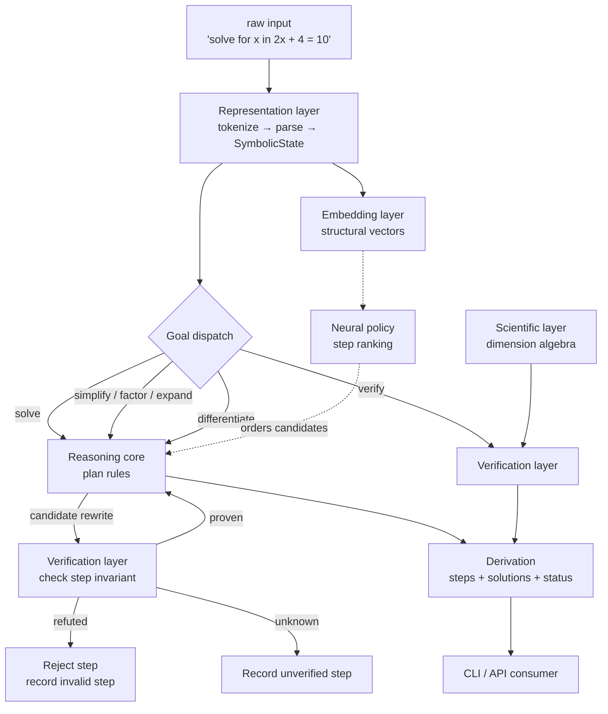

# ARIA Architecture

This document describes how the five layers of the proposal are realised, what
flows between them, and where the extension points are.

---

## 1. Data flow



Two invariants hold across the whole flow:

1. **Nothing downstream of the parser consumes raw text.** Everything is an
   `Expr` or a `SymbolicState`.
2. **Nothing leaves the reasoning core unverified.** A `Derivation` reports its
   own trace accuracy, and `Derivation.valid` is true only when every step
   carried a `proven` verdict.

---

## 2. Layer by layer

### 2.1 Representation layer — `aria/core/`

* **`ast.py`** — the object model. Eleven node types cover the proposal's
  representation model: numbers, symbols, sums, products, powers, function
  applications, derivatives, equations, relations, congruences and matrices.
  Constructors are *smart*: `mul` flattens, folds rational coefficients,
  combines identical factors into powers and sorts factors canonically, so
  equal expressions are structurally identical and hash equal. Canonical forms
  are what make structural deduplication, memoisation and graph encoding sound.

  Numbers are `fractions.Fraction` wherever the literal is exact; `float` is
  accepted but flagged inexact and is never used in a proof.

* **`parse.py`** — a hand-written recursive-descent parser. It is a grammar, not
  a model, so failure is loud (`ParseError` with a position) rather than a
  plausible guess. Precedence: relations < additive < multiplicative (including
  implicit juxtaposition) < unary sign < power (right-associative) < primary.
  Beyond notation, a small instruction grammar maps phrases to goals
  ("solve for `x` in …", "simplify …", "differentiate … with respect to `x`").

* **`state.py`** — `SymbolicState` carries the parsed expressions, a typed
  `Goal` (`SOLVE`, `SIMPLIFY`, `FACTOR`, `EXPAND`, `DIFFERENTIATE`, `VERIFY`,
  `PROVE`, `COMPUTE`, `DERIVE`, `ANALYZE`) and symbol assumptions.

* **`poly.py`** — exact algebra used by both the reasoner and the
  dependency-free verifier: multivariate rational normal forms, univariate
  coefficient extraction, polynomial division and gcd, rational-root enumeration,
  and extended Euclid / modular inverse for congruences.

### 2.2 Symbolic embedding layer — `aria/embed/`

Two views of the same tree:

| view | shape | use |
|---|---|---|
| `SymbolicGraph` | node feature tokens + edges | GNN / tree-transformer input, debugging |
| `TreeEmbedding` | `dim`-dimensional unit vector | similarity, policy features, clustering |

`TreeEmbedding` buckets *root-path signatures* (depth-weighted), node-head
counts, function counts and depth/size statistics into a fixed-width vector via
BLAKE2 hashing. Path signatures are what distinguish `(x+1)^2` from `x^2+1`:
same operator bag, different structure. The encoder is deterministic, has no
parameters, and needs no deep-learning stack — so results are reproducible in CI.

### 2.3 Neural reasoning core — `aria/neural/`

The neural component is a **ranker over symbolic transformations**, not a
generator of tokens or expressions.

```
state s, candidate s'  ──▶  features(s, s', goal, rule)  ──▶  logistic score  ──▶  ordering
```

Features are structural and goal-relative: size/depth delta, similarity to the
current state (small steps preferred), similarity to the goal form, operator
count deltas, shared variables, rule identity.

Rule-ordering training data is **mined, not labelled by humans**:
`mine_preferences` runs the engine, keeps only verified steps as positives, and
samples other applicable rules in the same state as negatives;
`mine_shortest_path_preferences` adds BFS
labels ("prefer the step that shortens the derivation"). The model is a
Bradley–Terry ranker trained by SGD with L2, persisted as a small JSON file
(`aria/neural/weights.json`).

`PolicySearch` performs beam search over one-step rewrites, ordered by policy
score, with a structural target test; the final answer is still verified. The
`OrderedSearch` and `RandomOrderSearch` classes provide the controlled baselines
used in [`EVALUATION.md`](EVALUATION.md).

### 2.4 Verification layer — `aria/verify/`

`Verifier` returns `Verdict(status, method, detail)` where `status ∈
{proven, refuted, unknown}`.

Decision procedure, in order:

1. structural equality of canonical forms (cheap, exact);
2. transcendental-constant guard (`π`, `e`, `i` are constants, not variables —
   numeric probing over them would be unsound, so those cases go straight to
   SymPy);
3. exact rational probing on random rational points — a mismatch is a genuine
   counterexample and yields `refuted`;
4. float probing through `log/exp/sin/cos/…` — refutation only, with a loose
   relative tolerance so rounding cannot manufacture a counterexample;
5. exact rational normal form (polynomial / rational-function identity);
6. SymPy — several *sound* normalisation strategies (`simplify`, `together`,
   `expand`, `expand_log(force=True)`, `logcombine(force=True)`, `trigsimp`,
   `cancel`, `radsimp`), each of which is a valid rewriting of the difference.

Step verification dispatches on the step's declared invariant (see the table in
the README). This matters: an implementation that merely re-checks "does the new
expression look simplified" cannot detect unsound equation manipulation, whereas
checking *residual proportionality* rejects squaring both sides automatically.

### 2.5 Scientific reasoning layer — `aria/science/`

A dimension is an exponent vector over `(M, L, T, I, Θ, N, J)` with rational
entries, so multiplication, division and powers are exact linear algebra.
`infer_dimension` walks the expression tree: sums require homogeneous terms,
products add exponents, numerics are dimensionless, and transcendental functions
require dimensionless arguments. `check_equation` compares both sides;
`derive_dimension` solves a law for an unknown quantity's dimension by treating
the law as a linear constraint on exponents.

The law library (`newton_second`, `mass_energy`, `kinetic_energy`, `gravitation`,
`ohms_law`, `coulomb`, `wave_speed`, `ideal_gas`, `planck_energy`) is checked by
the same machinery — including a deliberately malformed control law in the
benchmark, so a passing suite demonstrates the checker discriminates rather than
always agreeing.

---

## 3. Control flow inside the reasoner

```
SymbolicEngine.run(state)
  ├── SOLVE        → solve(equation, var) | solve_congruence(cong, var)
  ├── SIMPLIFY     → fixpoint over SIMPLIFY_RULES, one verified step per change
  ├── EXPAND       → expand() then simplification rules
  ├── FACTOR       → fixpoint over FACTOR_RULES
  ├── DIFFERENTIATE→ derivative rules, then simplification, then independent check
  └── VERIFY       → Verifier.claim
```

`solve` is a small planner, not a search:

1. `move_all_to_one_side` — residual `lhs − rhs`, verified by residual scaling;
2. simplification rounds on the residual;
3. branch on degree:
   * degree 1 → isolate the variable term, then divide by its coefficient;
   * degree 2 with two rational roots → factor, then a `zero_product_rule` step
     per root (each verified by substitution);
   * degree 2 otherwise → normalise monic, then the quadratic formula, with
     radicals simplified (`√8 → 2√2`) and complex roots labelled;
   * degree ≥ 3 → complete rational-root factorisation, else report `partial`
     with an explicit reason;
4. every candidate solution is substituted back into the original equation.

`partial` is a first-class outcome: the engine never presents an unfinished
derivation as solved.

---

## 4. Extension points

| To add… | Touch |
|---|---|
| a rewrite rule | decorate a function with `@rule(name, kind, description)` in `aria/reason/rules.py`; add its name to `SIMPLIFY_RULES`, `FACTOR_RULES` or `EXPAND_RULES` |
| a goal type | extend `GoalKind` and the dispatcher in `SymbolicEngine.run` |
| a verification backend (Z3, Lean, Mathematica) | add a module next to `sympy_backend.py` and a branch in `Verifier` |
| a physical law | add an entry to `LAW_LIBRARY` (equation + dimensions); it is picked up by CLI, tests and benchmark |
| a benchmark task | append a `Task` to `aria/bench/tasks.py` with an independently stated expectation |

---

## 5. Performance notes

* Canonical constructors make structural equality and hashing cheap, which lets
  the search deduplicate visited states by canonical key.
* Polynomial expansion is capped (`poly.MAX_TERMS`) and rule application is
  wrapped to swallow `RecursionError`/`OverflowError` and report "no candidate"
  instead of crashing.
* The verifier's numeric probes are bounded (`samples=24`, seeded), so
  verification is reproducible and its cost is predictable.
* `max_iterations` bounds every fixpoint loop.

---

## 6. What ARIA deliberately does not do

* It does not guess. If the grammar cannot parse the input, it raises.
* It does not claim undecided results as true. `unknown` propagates.
* It does not use the neural model to produce answers. The model orders
  candidate rewrites; the rules produce them and the verifier accepts them.
